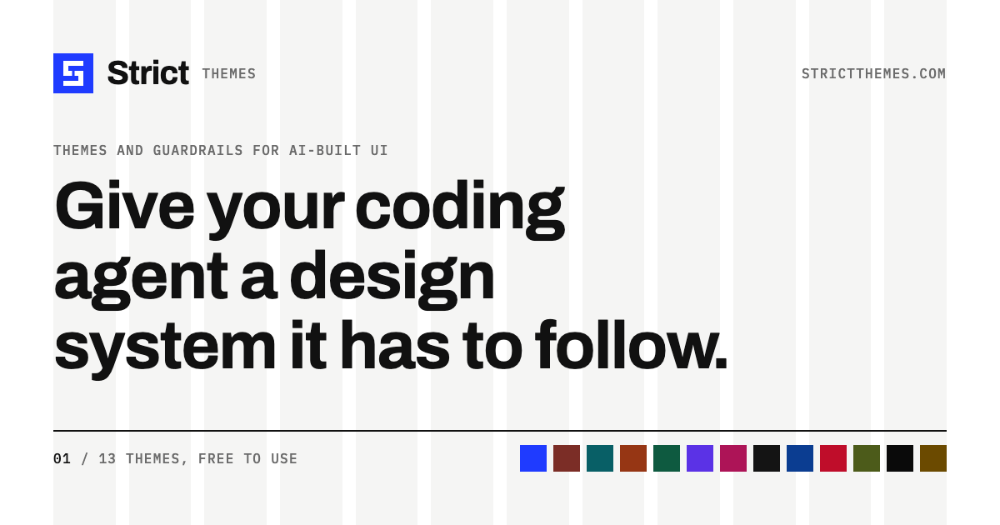

# Strict

**Themes and guardrails for AI-built UI.**

A Strict theme is one `DESIGN.md` file: design tokens your coding agent reads,
the reasoning behind them, and a `strict` block of rules. Strict Check then
reads what the agent built and lists every color, size, space and corner that
left the theme.

[](https://github.com/strictthemes/strictthemes/actions/workflows/ci.yml)
[](https://www.npmjs.com/package/@strictthemes/check)
[](https://www.npmjs.com/package/@strictthemes/spec)
[](LICENSE)

[Website](https://strictthemes.com) ·
[Themes](https://strictthemes.com/themes) ·
[The spec format](https://strictthemes.com/spec) ·
[Strict Check](packages/check#readme)

[](https://strictthemes.com)

Everything here is free under the [MIT licence](LICENSE). There is no paid
tier.

## Start

**1. Install a theme** into a shadcn project. This one is Strict One; the
[other seventeen](#themes) install the same way.

```bash
npx shadcn@latest add https://strictthemes.com/r/strict-one.json
```

Each theme also comes as a Tailwind CSS v4 theme, Nuxt UI palettes and W3C
design tokens: see its page on [strictthemes.com/themes](https://strictthemes.com/themes).

**2. Give the agent the theme's `DESIGN.md`**, and one of its page prompts if
you want a whole page. Every theme has five: full briefs for a landing page, a
dashboard, a shop, an essay and more.

**3. Check what it built**, in a project with a `DESIGN.md` in its root:

```bash
npx @strictthemes/check . --dist dist
```

The report ends with a line like this one, and the command fails when there
are errors:

```
Failed: 67.7% of 93 measured values follow the theme. 6 errors, 0 warnings.
```

## Themes

Eighteen themes, each with a light and a dark mode and five page prompts.
Every link opens the theme's page, with a live preview and the pages a coding
agent built from its prompts.

| Theme | What it is for |
|---|---|
| [Strict One](https://strictthemes.com/themes/strict-one) | A disciplined, Swiss-grid editorial theme. One accent, hard edges, no decoration. |
| [Recital](https://strictthemes.com/themes/recital) | A warm, literary theme for long reading. Paper tones, a serif voice, and one oxblood accent. |
| [Avion](https://strictthemes.com/themes/avion) | A calm, precise theme for dashboards and tools. Cool greys, clear numbers, and one teal signal. |
| [Kiln](https://strictthemes.com/themes/kiln) | A warm, hand-made theme for shops and studios. Clay paper, a fired-terracotta accent, and type with a little wobble. |
| [Ledger](https://strictthemes.com/themes/ledger) | A sober, exact theme for money and reports. Cream paper, pine green, a serif for the big numbers. |
| [Cipher](https://strictthemes.com/themes/cipher) | A sharp, technical theme for developer tools. Monospace headings, cool paper, electric violet and one acid-lime signal. |
| [Sorbet](https://strictthemes.com/themes/sorbet) | A friendly, rounded theme for consumer apps. Peach cream, raspberry, butter yellow and soft, generous shapes. |
| [Atelier](https://strictthemes.com/themes/atelier) | A spare, high-fashion theme for portfolios and houses. Ivory and black, a didone at display size, and no corner rounded. |
| [Civic](https://strictthemes.com/themes/civic) | A plain, trustworthy theme for public services and health. WCAG AAA contrast, large type, and nothing left to guess. |
| [Dispatch](https://strictthemes.com/themes/dispatch) | A loud, fast theme for news and sport. Newsprint, black rules, condensed headlines and a breaking-news red. |
| [Tisane](https://strictthemes.com/themes/tisane) | A soft, unhurried theme for food, wellness and places to stay. Oat paper, olive green, a peach accent and a rounded serif. |
| [Voltage](https://strictthemes.com/themes/voltage) | A bold poster of a theme for launches, events and music. A yellow page, black ink, thick shapes and electric blue. |
| [Nocturne](https://strictthemes.com/themes/nocturne) | A dusky, cinematic theme for film, music and nightlife. Lilac-grey paper by day, aubergine and gold by night. |
| [Counsel](https://strictthemes.com/themes/counsel) | A composed, formal theme for law firms, advisers and private offices. White paper, midnight navy, and gold used once. |
| [Passage](https://strictthemes.com/themes/passage) | A clear, airy theme for travel and booking. Pale-water paper, deep navy ink, and one hue of blue from light to dark. |
| [Ember](https://strictthemes.com/themes/ember) | A hot, dark-first theme for games, esports and sport. Blue-black, ember red, and an amber signal from the same fire. |
| [Gauge](https://strictthemes.com/themes/gauge) | A plain, exact theme for hardware, parts and spec sheets. Nine steel greys, dense tables, and no accent color at all. |
| [Confetti](https://strictthemes.com/themes/confetti) | A light, cheerful theme for invitations, parties and gift lists. Lilac-white paper, plum ink, and pastel pink, sky and lilac. |

To write your own, read [the spec format](https://strictthemes.com/spec) and
lint the file as you go:

```bash
npx @strictthemes/spec lint DESIGN.md
```

## Strict Check

Strict Check answers one question: did the agent stay inside the theme?

- **The code.** Off-theme classes, hand-written colors, fonts the theme does
  not declare, gradients and emoji. It needs no build and no browser.
- **The rendered pages.** Colors, contrast, type, spacing and corners as the
  browser draws them, in every color mode, at 1280px and 375px.
- **In CI.** The same command fails a job on errors and writes a report. This
  repo checks its own site with it on every pull request.

The agent that wrote the UI can run the check itself. Connect the MCP server
in Claude Code, Cursor or another MCP client:

```json
{
  "mcpServers": {
    "strict-check": {
      "command": "npx",
      "args": ["-y", "@strictthemes/check", "mcp"]
    }
  }
}
```

Or give it the [skill](skills/strict-check/SKILL.md), which says when to run
the check, how to read the report and how to fix each rule. The
[guide](packages/check#readme) has every option, the rules, and a GitLab CI
and a GitHub Actions example.

## What is in this repo

| Package | What it does | Status |
|---|---|---|
| [`@strictthemes/spec`](packages/spec) | Parses, lints and exports Strict design specs (`DESIGN.md` + a `strict` rules block). Everything else builds on it. | First version, [on npm](https://www.npmjs.com/package/@strictthemes/spec) |
| [`@strictthemes/themes`](packages/themes) | The eighteen themes, five page prompts for each, and the build that turns them into a shadcn registry. | First version, served from strictthemes.com/r |
| [`@strictthemes/check`](packages/check) | Strict Check: checks a project's code and its rendered pages against a spec, and scores it. Command, MCP server and library. | First version, [on npm](https://www.npmjs.com/package/@strictthemes/check) |
| [`@strictthemes/site`](apps/site) | strictthemes.com, built with Astro: theme pages with live previews, a built example page for every page prompt, the registry and the spec docs. | Live |
| [`skills/strict-check`](skills/strict-check/SKILL.md) | The skill that has a coding agent run Strict Check on its own work. | First version |

Planned: a generator that writes a `DESIGN.md` from a site's address, theme
components, and a kit of components for agent interfaces. The roadmap is on
[strictthemes.com](https://strictthemes.com).

## Develop

Needs Node 24 (`nvm use`).

```bash
npm install
```

```bash
npm test
```

```bash
npm run build
```

`npm run build` also writes the theme registry to `packages/themes/dist`.
Run the site locally with `npm run dev --workspace @strictthemes/site`.

Try the CLI on the example theme after building:

```bash
node packages/spec/dist/cli.js lint packages/spec/examples/strict-one/DESIGN.md
```

```bash
node packages/spec/dist/cli.js export packages/spec/examples/strict-one/DESIGN.md --format shadcn
```

## Contribute

Bug reports, theme ideas and pull requests are welcome. [CONTRIBUTING.md](CONTRIBUTING.md)
says how to set up, what a change needs before it can be merged, and how to
propose a theme. To report a security problem, see [SECURITY.md](SECURITY.md).

## Licence

[MIT](LICENSE). The themes, the prompts and the code are free to use, in
personal and commercial work.
